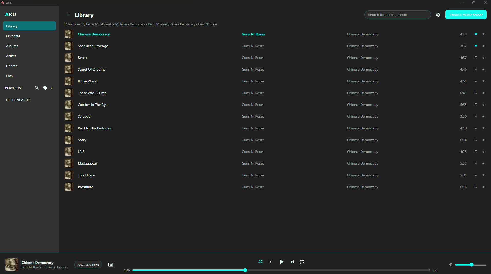

# AKU

AKU is a small, offline-first music player for Windows. Point it at a folder,
and it reads your files' tags and streams them straight from disk — no account,
no upload, no cloud.

<!-- Screenshot placeholder: drop a PNG at docs/screenshot.png and it will show here. -->


## Features

- **Plays your files in place** — recursive library scan, streamed from disk
- **Rich tags** — title, artist, album, genre, year, duration, and audio quality
  (codec, bitrate, sample rate, lossless) read via ID3/FLAC/etc. metadata
- **Browse views** — Albums, Artists, Genres and Eras, each with its own detail page
- **Search** — filters group names on browse pages, track names everywhere else
- **Queue, shuffle and repeat**, plus favorites and playlists
- **Genre tools** — group tracks into auto playlists, or fill in missing genres
  from the iTunes Search API
- **Mini player** — a compact always-on-top window (Bar / Card / Minimal styles,
  plus a cover-only cube) that remote-controls the main window
- **Themes** — Crimson (default), Terminal, Ocean and Sage
- **Resume playback**, configurable display density, and more in Settings

## Install

### Windows (recommended)

Download `AKU.exe` from the [latest release](https://github.com/4KIR4fo/AKU-PLAYER/releases/latest)
and run it. It is a self-contained portable build — nothing to install, and your
settings live in `%APPDATA%\aku-player`.

### One-line installer (from source)

Requires [Node.js](https://nodejs.org/) 20 or newer and Git:

```powershell
irm https://raw.githubusercontent.com/4KIR4fo/AKU-PLAYER/main/scripts/install.ps1 | iex
```

This clones the project into `%LOCALAPPDATA%\AKU-PLAYER`, installs dependencies
and adds Desktop/Start Menu shortcuts. Pass `-Build` to also produce
`dist\AKU.exe` via electron-builder, or `-Uninstall` to remove it.

### From source, by hand

```bash
git clone https://github.com/4KIR4fo/AKU-PLAYER.git
cd AKU-PLAYER
npm install
npm start
```

## Requirements

- Windows 10 or 11
- Node.js 20+ (only needed for the source install)

## Notes and limitations

- Supported formats: `mp3`, `m4a`, `aac`, `ogg`, `oga`, `opus`, `wav`, `flac`.
  `wma`, `alac`, `ape`, `wavpack` and DSD are not playable — Chromium cannot
  decode them.
- The iTunes categorizer is the only feature that uses the network. Everything
  else stays on your machine.
- Adding a huge folder takes a moment on the first scan; the library is cached
  in memory only, so the next launch rescans.

## Credits

Built with [Electron](https://www.electronjs.org/). Tag parsing by
[music-metadata](https://github.com/Borewit/music-metadata). Missing genres are
filled from the [iTunes Search API](https://performance-partners.apple.com/search-api).

## License

[MIT](LICENSE)
